# ha-routine-card

[](https://www.home-assistant.io/integrations/marketplace/)
[](https://github.com/juju35/ha-routine-card/actions/workflows/hacs.yml)
[](https://github.com/juju35/ha-routine-card/actions/workflows/validate.yml)
[](https://github.com/juju35/ha-routine-card/actions/workflows/lint.yml)
[](https://github.com/juju35/ha-routine-card/releases/latest)
[](https://github.com/juju35/ha-routine-card/blob/main/LICENSE)
[](https://buymeacoffee.com/julienstep9)

<p align="center">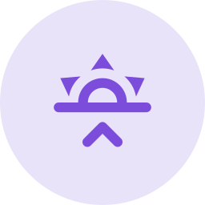</p>

<p align="center">
  &nbsp;&nbsp;
  &nbsp;&nbsp;
  
</p>

A Lovelace card for **daily routines** — getting ready in the morning, going to bed in the evening: every step as a tile, a timer on the step in progress, a progress ring and the week's stars.

[](https://my.home-assistant.io/redirect/marketplace_repository/?owner=juju35&repository=ha-routine-card&category=plugin)

| Card | Type | What it shows |
|---|---|---|
| [Routine](#screenshots) | `custom:routine-card` | The step in progress with its timer and a progress ring, every step as a tile, the week's stars and a button to mark the step done. |
| [Routine mini](#routine-mini) | `custom:routine-mini-card` | The routine on two lines — its progress ring, the step in progress and its timer — with a zoom to the full card. |

| In progress | Evening |
|---|---|
| 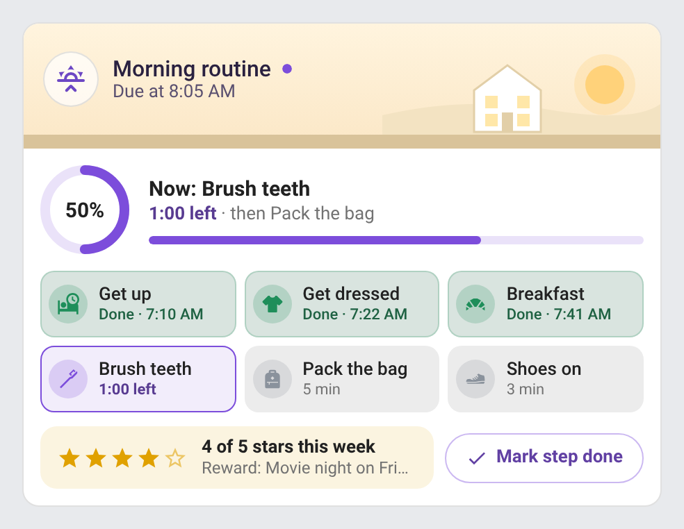 | 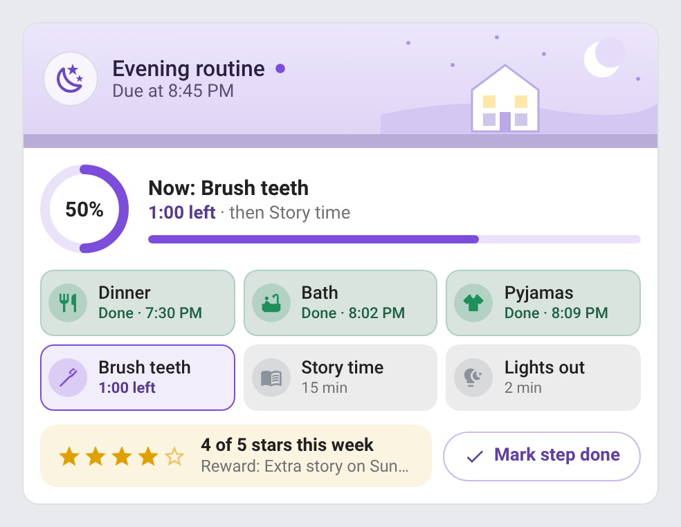 |

## Features

- **The step in progress in big**: a progress ring, its name, a timer started when the step before it was done (it turns red once over), and what comes next
- **Every step as a tile**: done (green, with the time it was done), in progress (accent, its timer), to do (grey, its duration); **tap a tile** to tick or untick it, hold it for its details
- **Mark step done**: one button turns the step in progress on
- **Status pill**: *3 / 6 · 9 min*, *Not started*, *All done*, or *Late · 2 left* once the due time has passed (the card then gets a red outline and its badge pulses)
- **The week's stars**: from a counter (or any number), with a goal and a reward
- **Illustrated header**: a house on a hill; in the morning the sun rises with the routine's progress, in the evening the windows go dark one by one under the moon; sparkles once everything is done; the dark theme darkens the sky
- **Mini card**: two lines and a progress ring for a badge; its zoom button opens the full card in place
- Visual editor for both cards, light and dark themes, 22 languages, no external dependency

## Supported integrations

The card needs no integration of its own: each step is a Home Assistant helper or any entity that is `on` once done.

| | Integration | What the cards use |
|:---:|---|---|
|  | [Input boolean](https://www.home-assistant.io/integrations/input_boolean/) (built in) | One toggle helper per step: `on` = done (a `switch` or any on/off entity works too) |
|  | [Counter](https://www.home-assistant.io/integrations/counter/) (built in) | The week's stars (`stars_entity`; an `input_number` or a numeric sensor works too) |
|  | [Automations](https://www.home-assistant.io/docs/automation/) (built in) | Resetting the steps every day, adding a star when the routine is done (see [below](#resetting-the-steps)) |

## Installation

### Via the Marketplace (recommended)

Click the button below to add the repository directly:

[](https://my.home-assistant.io/redirect/marketplace_repository/?owner=juju35&repository=ha-routine-card&category=plugin)

Or manually:

1. Open **Settings → Marketplace → Add from link** (top right; this needs a GitHub account connected)
2. Add `https://github.com/juju35/ha-routine-card` — Type: **Dashboard**
3. Open **Routine Card** and click **Install**
4. Clear your browser cache and refresh

The Marketplace registers the dashboard resource for you.

### Manual

1. Download `ha-routine-card.js` and the `ha-routine-card.i18n.*.js` translation files from the [latest release](https://github.com/juju35/ha-routine-card/releases/latest)
2. Copy them all to `/config/www/` (without the translation files, the cards show in English)
3. Go to **Settings → Dashboards → Resources** → Add resource:
   - URL: `/local/ha-routine-card.js`
   - Type: **JavaScript Module**
4. Clear your browser cache and refresh

## Configuration

Every option is in the visual editor; `steps`, a list, is written as YAML in its advanced section. In YAML:

```yaml
type: custom:routine-card
title: Morning routine
deadline: "08:05"
steps:
  - entity: input_boolean.routine_get_up
    name: Get up
    icon: mdi:bed-clock
    duration: 5
  - entity: input_boolean.routine_dress
    name: Get dressed
    icon: mdi:tshirt-crew
    duration: 10
  - entity: input_boolean.routine_breakfast
    icon: mdi:food-croissant
    duration: 15
  - input_boolean.routine_teeth # an entity id alone: its name and icon
stars_entity: counter.routine_stars
stars_goal: 5
reward: Movie night on Friday

# Two lines on a phone dashboard
type: custom:routine-mini-card
period: evening
steps:
  - input_boolean.routine_bath
  - input_boolean.routine_story
```

| Option | Type | Default | Description |
|---|---|---|---|
| `steps` | list | | Both, as YAML (in the editor's advanced section too): the steps in order — `entity` (on = done), `name` (default: the entity's name), `icon`, `duration` (minutes, for the timer) — or entity ids |
| `title` | string | `Morning routine` / `Evening routine` | Both: card title (by `period`) |
| `show_title` | boolean | `true` | Both: show the title |
| `subtitle` | string | `Due at <deadline>` | Both: the line under the title |
| `show_subtitle` | boolean | `true` | Both: show the subtitle |
| `icon` | string | by `period` | Both: the header's icon |
| `navigation_path` | string | | Both: a tap on the header opens this dashboard path |
| `period` | string | `auto` | Both: `morning`, `evening`, or `auto` (morning until 3 pm): the default title and the illustration |
| `deadline` | string | | Both: the due time (`HH:MM`); past it with steps left, the routine is late |
| `stars_entity` | string | | Full card: a counter or a number holding the week's stars |
| `stars_goal` | number | `5` | Full card: how many stars to earn (1 to 10) |
| `reward` | string | | Full card: shown under the stars |
| `columns` | number | `3` | Full card: tiles per row (1 to 4; one per row on a narrow card) |
| `illustration` | boolean | `true` | Both: the illustrated header (`false`: the classic header) |
| `illustration_theme` | string | `auto` | Both: `auto` (follows the Home Assistant theme: night with a dark theme, day with a light theme), `day` or `night` |
| `animations` | boolean | `true` | Both: the sun's glow, the stars and the sparkles |
| `zoom` | boolean | `true` | Mini card: the zoom button |
| `language` | string | Home Assistant's | Advanced: one of the [languages](#translations) |

### Resetting the steps

The card reads the steps' entities and never resets them on its own: an automation turns them off every day, and can add a star once the routine is done.

```yaml
automation:
  - alias: Morning routine — reset
    triggers:
      - trigger: time
        at: "03:00:00"
    actions:
      - action: input_boolean.turn_off
        target:
          entity_id:
            - input_boolean.routine_get_up
            - input_boolean.routine_dress
            - input_boolean.routine_breakfast
            - input_boolean.routine_teeth
  - alias: Morning routine — star
    triggers:
      - trigger: state
        entity_id: input_boolean.routine_teeth # the last step
        to: "on"
    conditions:
      - condition: time
        before: "08:05:00"
    actions:
      - action: counter.increment
        target:
          entity_id: counter.routine_stars
```

## Screenshots

| In progress | Not started | Late |
|---|---|---|
|  | 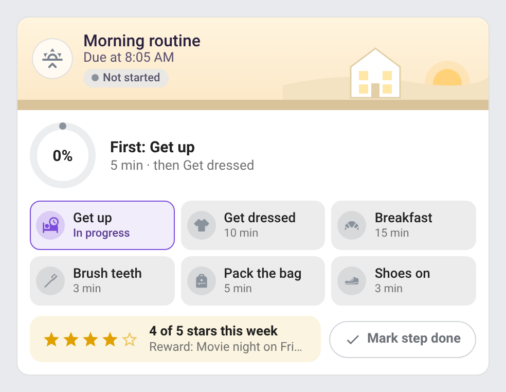 | 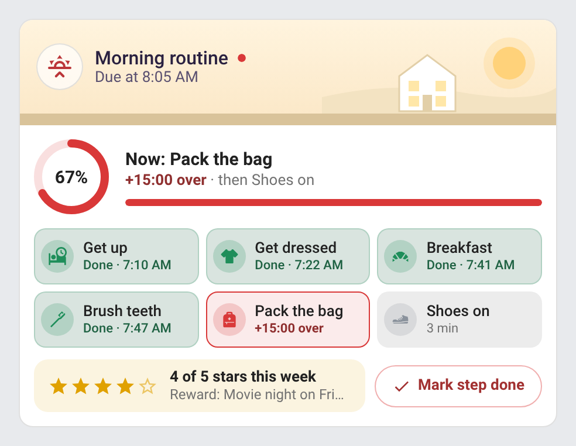 |
|  | 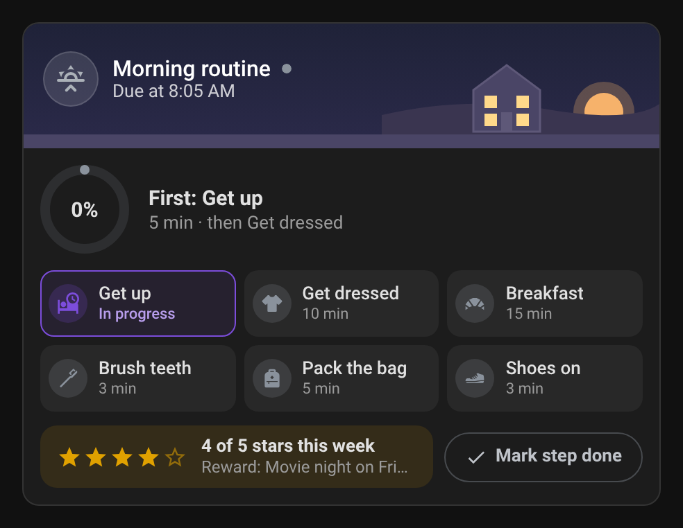 | 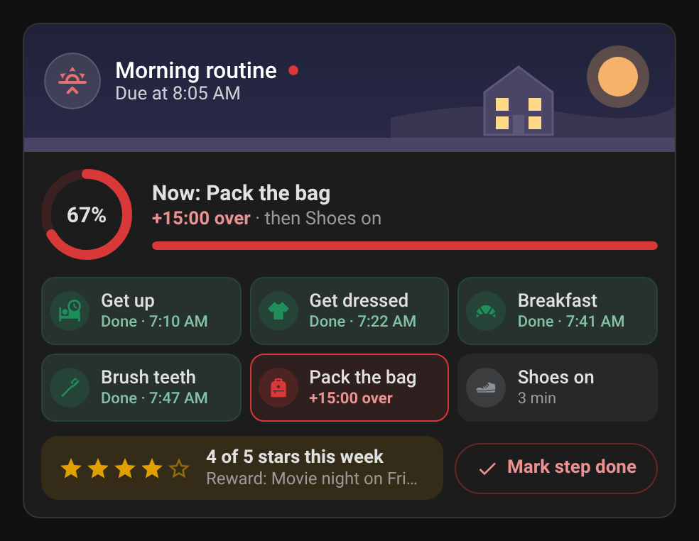 |

| All done | Evening | Narrow |
|---|---|---|
| 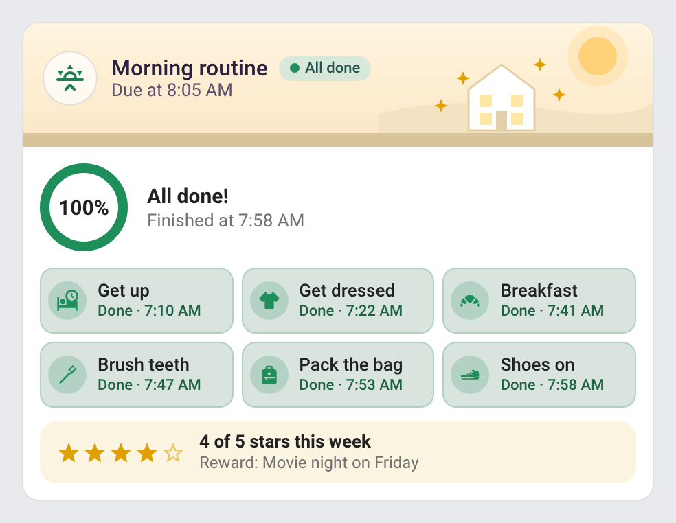 |  | 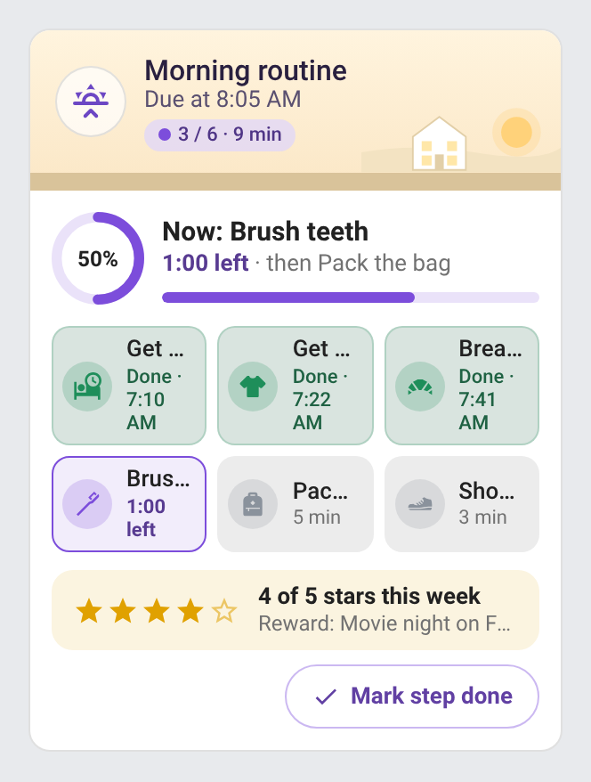 |
| 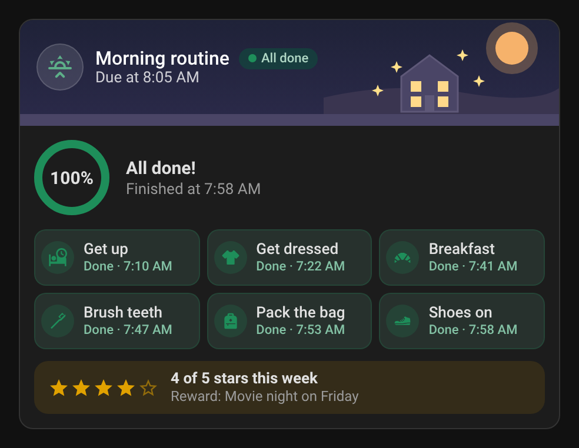 | 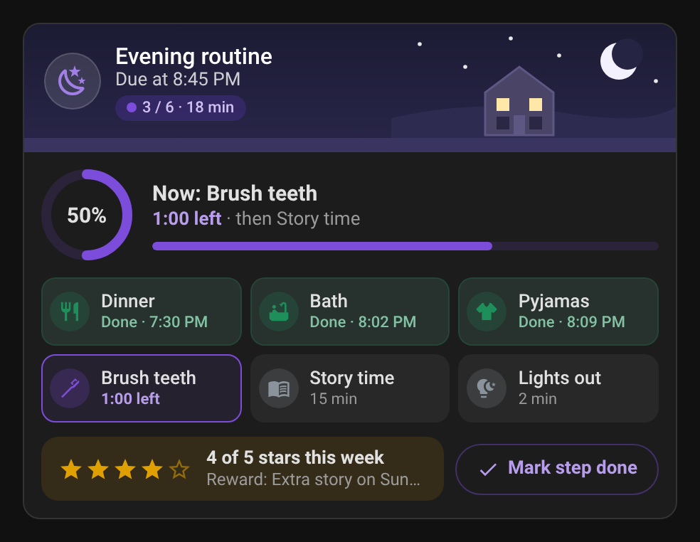 | 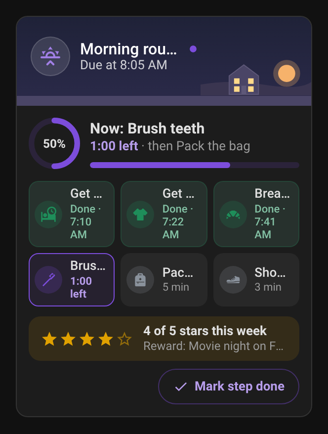 |

**Sunrise animation**: in the morning, the sun glows over the house and climbs with the routine's progress (still with `animations: false`, or when the system asks for reduced motion).

| Light | Dark |
|---|---|
|  | 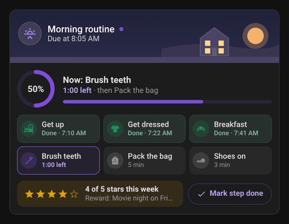 |

**Sparkles animation**: once every step is done, sparkles twinkle around the house.

| Light | Dark |
|---|---|
| 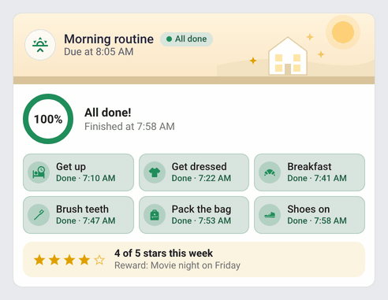 | 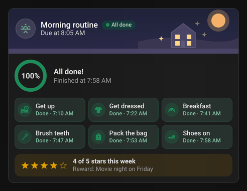 |

**Evening animation**: the stars twinkle over the house, whose windows go dark as the steps are done.

| Light | Dark |
|---|---|
| 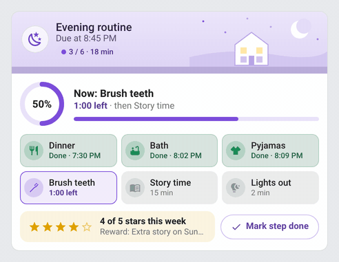 | 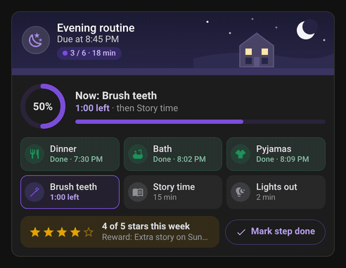 |

### Routine mini

| In progress | All done | Zoomed in |
|---|---|---|
| 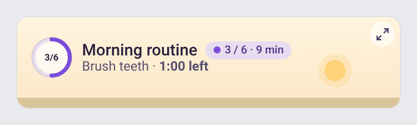 | 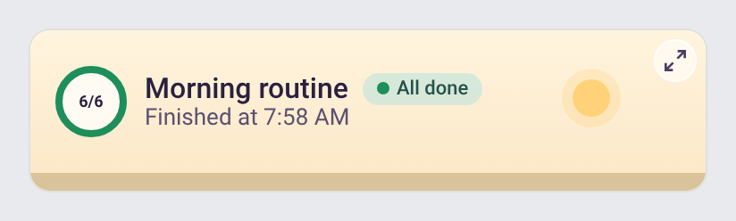 | 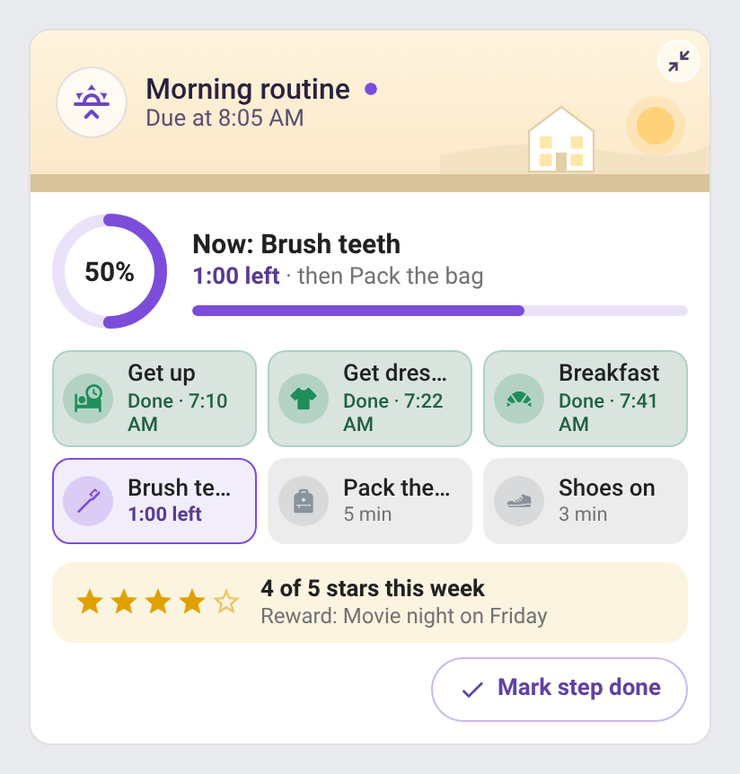 |
| 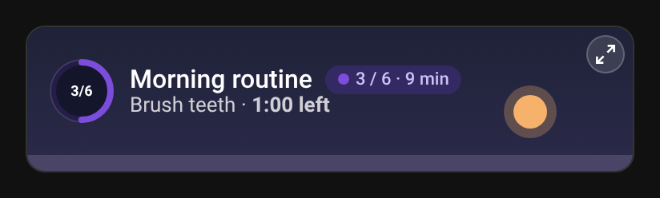 | 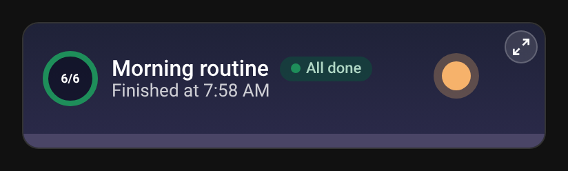 | 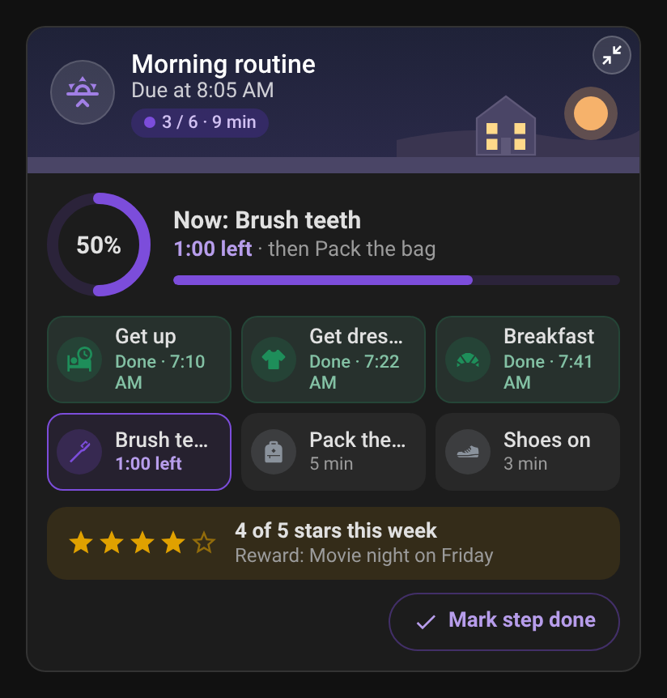 |

## How it works

- **Done**: a step is done when its entity is `on`; the step in progress is the first one not done (an unavailable step is skipped)
- **Timer**: it starts when the step before it was done (that entity's last change, today) and counts the step's `duration` down; the first step has no timer until it is done, so it shows its duration
- **Minutes left**: the time left on the step in progress and the whole duration of the steps after it
- **Late**: past `deadline` with steps left
- **Refresh**: the card redraws on each change of its entities; the timer's text is updated every second without redrawing the card
- **Actions**: a tap on a tile toggles its entity (`homeassistant.toggle`), the button turns the step in progress on (`homeassistant.turn_on`); a step without an entity is shown but cannot be ticked

## Development

```bash
npm install
npm run build        # stamps the version of package.json into dist/ha-routine-card.js
npm run check        # builds and checks the bundle (run in CI)
npm test             # unit tests
npm run screenshots  # renders the cards with a mock routine into screenshots/ (and the GIFs, needs ffmpeg)
```

The source is split into ES modules under `src/shared/` (entry `src/shared/index.js`); `npm run build` assembles them (`scripts/bundle.mjs`) into the single file the Marketplace serves.

`dist/` is not committed: `npm run build` creates it locally, CI builds it on every push, and the release workflow attaches the built files to the release, which is where the Marketplace installs them from.

### Releasing

1. Bump `version` in `package.json`
2. Add a `## <version>` section at the top of [CHANGELOG.md](https://github.com/juju35/ha-routine-card/blob/main/CHANGELOG.md)
3. Merge a `feat` or `fix` pull request into `main`: the **Release** workflow builds the card, creates the tag and the GitHub release with the changelog section as notes, and attaches `ha-routine-card.js` and its translation files

## Translations

The card auto-detects the language from your Home Assistant settings. Currently supported:

| Language | Code |
|---|---|
| English | `en` |
| Français | `fr` |
| Deutsch | `de` |
| Español | `es` |
| Српски | `sr` |
| Srpski (latinica) | `sr-Latn` |
| Italiano | `it` |
| Nederlands | `nl` |
| Português (Portugal) | `pt` |
| Polski | `pl` |
| Română | `ro` |
| Dansk | `da` |
| Svenska | `sv` |
| Български | `bg` |
| Русский | `ru` |
| Українська | `uk` |
| Magyar | `hu` |
| Slovenčina | `sk` |
| Čeština | `cs` |
| Slovenščina | `sl` |
| Latviešu | `lv` |
| Ελληνικά | `el` |

Contributions for additional languages are welcome!

## License

[MIT](https://github.com/juju35/ha-routine-card/blob/main/LICENSE)

## Support

If you find this project useful, you can support its development:

<a href="https://buymeacoffee.com/julienstep9"></a>
